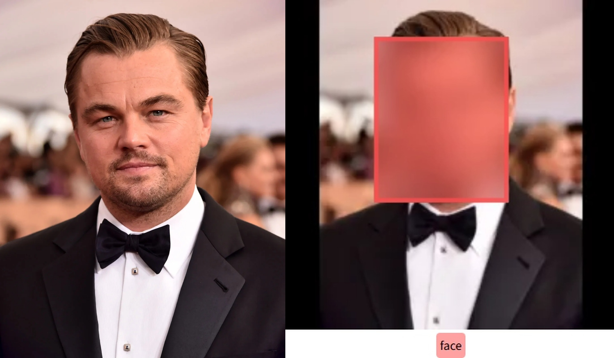

# Face blurring project

This project detects whether an image contains a human, cat or dog.
For humans, the model localizes the face area with a bounding box and blurs it.


*Left: original image. Right: predicted face box (red) with blurred face. Ground-truth box shown in green.*

## Quick start

The interactive interface is served by the FastAPI application, which mounts the Gradio UI at `/`. Download the three pretrained model files from the [v0.1.0 release](https://github.com/MohamadSamaei/face-blurring-app/releases/tag/v0.1.0) and put them in a `weights/` directory at the project root before starting the server.

Install CPU PyTorch and the application dependencies:
```bash
python -m pip install torch torchvision --index-url https://download.pytorch.org/whl/cpu
python -m pip install -r requirements.txt
```

Start the API and Gradio interface:

```bash
python -m uvicorn src.api:app --host 0.0.0.0 --port 8000
```

Open <http://localhost:8000/> in a browser. The API also provides `/health` and `/predict` endpoints. The model weights must be present for the application to start successfully.

## Model card

- **Task:** Human / cat / dog classification + face bounding-box regression for humans.
- **Training data:** Custom dataset (~8k human images with face boxes, ~375 cats, ~457 dogs), balanced via weighted sampling.
- **Metrics (validation):**
  - Accuracy: 96.74%
  - Avg regression loss (Huber): 0.00081
- **Intended use:** Demonstration, education, and experimentation. Not intended for production or security-critical applications.
- **Limitations:**
  - Trained on single-face images.
  - Performance may degrade on cases where the face is located of the periphery of the image.


## Dataset

The training and validation image dataset is not distributed with this project. Users may bring their own dataset, provided it can be represented in the format expected by the current training code. The released pretrained weights are a separate artifact; their non-commercial use restriction is described below.

The current code expects two annotation CSV files, one for training and one for validation, plus an image folder for each split. The default paths are configured in configs/default.yaml:

- data/humans_cats_dogs_train.csv
- data/humans_cats_dogs_val.csv
- data/image_folder_train/
- data/image_folder_val/

Change those paths to match your local dataset. Keep the image files named as referenced by the image_id column.

### Annotation format

Both CSVs must contain these columns:

- image_id: image filename, such as 000001.jpg; the named file must exist in the corresponding image folder.
- category: 0 for human, 1 for cat, or 2 for dog.
- x_1, y_1, width, height: face bounding box in pixel coordinates for human images. Cat and dog rows do not use a face box.

The train and validation loaders read the CSV path supplied by the config; they do not select rows using a split column. If your annotations are in one combined CSV with a split field, create separate train and validation CSVs or adapt the loader to filter by that field.

This format supports the project's current three classes and one face box per human image. Other class labels or multi-face annotations require changes to the dataset/model code.

## Installation

```bash
git clone https://github.com/MohamadSamaei/face-blurring.git
cd face-blurring

# Install dependencies for users
pip install -r requirements.txt

# Install CPU PyTorch (or choose the PyTorch build that matches your hardware)
python -m pip install torch torchvision --index-url https://download.pytorch.org/whl/cpu

# Install runtime dependencies
python -m pip install -r requirements.txt
```

For development and training, install the project dependencies declared in `pyproject.toml` (including PyTorch, torchvision, Albumentations, and training utilities). `requirements-dev.txt` contains pinned dependencies for the author's CUDA development environment; its CUDA-specific PyTorch pins may not suit every machine.


## Pre-trained weights
Pre-trained weights are provided for **research and educational use only**.

- Download: [v0.1.0 release](https://github.com/MohamadSamaei/face-blurring-app/releases/tag/v0.1.0)
- These weights are trained using the CelebA dataset and are subject to its non‑commercial license.  
  **Commercial use of these weights is not permitted.**
The provided weights were obtained with the following setting:
- **Regression loss:** Huber
- **Training augmentations:**
    `LongestMaxSize`, `PadIfNeeded`, `HorizontalFlip`, `BBoxSafeRandomCrop`, `Resize`, `Affine`,  
  `OneOf([MotionBlur, MedianBlur, GaussNoise, ImageCompression])`,  
  `OneOf([ColorJitter, RandomBrightnessContrast, HueSaturationValue])`
- **epochs:** 25

**Validation performance:**

- overall accuracy: **96.74%**
- Average classification loss: **0.1276**
- Average regression loss: **0.0008**
- Average total loss: **0.1284**

### Using the pre-trained weights

1. Download the three files from the [v0.1.0 release](https://github.com/MohamadSamaei/face-blurring-app/releases/tag/v0.1.0):
   - `backbone.pth`
   - `classification_head.pth`
   - `regression_head.pth`

2. Put them directly in the project-root `weights/` folder.

3. The API, validation, visualization, and Gradio inference code load these files from `weights/`.

### Training with different settings
If you want to train a new model with different settings:

- Update hyperparameters in `configs/default.yaml`.

- Provide the train/validation CSVs and image folders expected by that config. Those files are not included in the repository.

- After training, the new weights will be saved to:
  - `weights/backbone.pth`
  - `weights/classification_head.pth`
  - `weights/regression_head.pth`

To use them in `app.py`, ensure the paths in `backbone.load_state_dict`, `classification_head.load_state_dict`, and `regression_head.load_state_dict` point to your weight files.

## Usage 
All commands are run from the project root

## Examples

A minimal demo notebook is provided to quickly test the model on a single image:

```bash
jupyter notebook examples/demo.ipynb
```

The notebook:
- Loads the pre-trained weights from `weights/`.
- Runs inference on a user-specified image.
- Draws the predicted face bounding box (for humans) and shows the blurred result.

To use it: 
1. Ensure pre-trained weights are present in `weights/`.
2. Open `examples/demo.ipynb` in Jupyter or VS Code.
3. Set `IMAGE_PATH` to the path of your test image.
4. Run all cells.


### Training
```bash
python main.py --mode train --config configs/default.yaml
```

Reads data paths and hyperparameters from `configs/default.yaml` and saves trained weights to `weights/`. This requires the dataset files and folders configured in that YAML file.

### Validation

```bash
python main.py --mode val --config configs/default.yaml
```

- Loads weights from `weights/`
- Evaluates classification accuracy and regression loss.
- Writes predictions to `predicted_coordinates.csv`.

### Visualization (drawing bounding boxes + face blurring) 

```bash
python main.py --mode visualize --config configs/default.yaml
```

- Reads 'predicted_coordinates.csv'
- Darws:
    - Ground-truth box in green
    - predicted box in red
    - blurred face region inside the predicted box 
- Saves annotated images to 'bb_predictions/'.

### Gradio demo and API

`app.py` defines the Gradio interface, but running `python app.py` alone does not launch it. Start the FastAPI app, which mounts Gradio at `/`:

```bash
python -m uvicorn src.api:app --host 0.0.0.0 --port 8000
```

- UI: <http://localhost:8000/>
- Health check: `GET /health`
- Image prediction: `POST /predict` with a multipart form field named `file` containing a PNG or JPEG image (maximum 5 MB). The response is a JPEG image.

Example request:

```bash
curl -X POST "http://localhost:8000/predict" \
  -F "file=@photo.jpg" \
  --output blurred.jpg
```
The server loads the model weights during startup, so all three files must be available in `weights/`.


### Docker

Build the image from the repository root:

```bash
docker build -t face-blurring-app .
```

Run it with the local model weights mounted into the container:

```bash
docker run --rm -p 8000:8000 -v "$PWD/weights:/app/weights:ro" face-blurring-app
```

Then open <http://localhost:8000/>. The Dockerfile does not copy model weights into the image, so the mounted `weights/` directory must contain all three `.pth` files. The repository currently names its ignore file `dockerignore`; Docker expects `.dockerignore`, so the current file is not applied to the build context.

### Tests and Github Actions

Run the API tests from the repository root after installing the test dependencies (`pytest` and `httpx`) and CPU PyTorch:

```bash
PYTHONPATH=. pytest tests/
```

The tests use a fake inference service and do not need pretrained weights. GitHub Actions runs this test command on pushes and pull requests targeting `main`; see the [workflow](.github/workflows/test.yaml).

### Configuration

Hyperparameters, paths, and visualization settings are defined in `configs/default.yaml`:

- Data paths: `train_csv`, `val_csv`, `image_folder_train`, `image_folder_eval`
- Training settings: `epochs`, `batch_size`, `lr_general`, `optimizer_general`
- Model input size: `width_target`, `height_target`
- Bounding box visualization: `box_color_pred`, `box_color_gt`, `box_width`

Edit the yaml file in order to change:
- Learning rate, batch size, number of epochs
- Loss functions (For regression there are choices among Huber or DIoU)
- Input resolution and other experiment settings

## Model
The architecture consists of: 

- **Backbone**: custom VGG-style CNN (5 convolutional blocks + final strided conv) producing a `[B, 512, 4, 4]` feature map
- **Classification head**: global average pooling + 2 layer MLP -> 3 classes (human/cat/dog).
- **Regression head**: a convolutional block for reducing the dimensionality from 512 to 128 + MLP -> 4 outputs (normalized `x1, y1, width, height`), constrained to `[0, 1]` using sigmoid

Training uses:
- weighted random sampler to address class imbalance
- classification loss: cross-entropy
- regression loss: Huber or DIoU (only applied to samples classified as human)

## Metrics

Validation results for the provided v0.1.0 pretrained weights:
- classification accuracy: **96.74%**
- average regression loss (huber): **0.00081**
- average total loss: **0.128**

The weights are available for non‑commercial research use only.


## Project structure
```text
├── .github/workflows/test.yaml  # GitHub Actions test workflow
├── Dockerfile                   # API/Gradio container
├── README.md
├── app.py                       # Gradio interface builder
├── main.py                      # CLI: train/val/visualize
├── configs/default.yaml         # Data paths and experiment settings
├── requirements.txt             # Runtime dependencies
├── requirements-dev.txt         # Pinned development dependencies
├── requirements-prod.txt        # Runtime dependency list
├── pyproject.toml               # Package metadata and dependency declarations
├── tests/test_api.py            # API tests
├── src/
│   ├── api.py                   # FastAPI app and Gradio mount
│   ├── inference.py             # Model loading and prediction
│   ├── models.py                # Backbone and prediction heads
│   ├── dataset_train.py         # Training dataset loader
│   ├── dataset_val.py           # Validation dataset loader
│   ├── train.py                 # Training loop
│   ├── validate.py              # Validation loop
│   ├── visualize.py             # Bounding box drawing and blurring
│   └── loss_function_DIoU.py    # DIoU regression loss
├── assets/demo.jpg
├── data/okf/                    # Annotation metadata; not the full image dataset
├── examples/demo.ipynb
└── weights/                     # Downloaded or trained model weights (not committed)
```


## Extending the project
- Adapt the project to be suitable for multi-face detection
- Make the model's performance more robust in out-of-distribution images (such as images with the face at more peripheral areas and images with many details in them)

## License
This project is released under the MIT License. See the [LICENSE](LICENSE) file for details.
**Note on pre-trained weights:**  
The pre-trained weights are trained using the CelebA dataset and are provided for **non‑commercial, research and educational use only**, in accordance with the CelebA dataset license. Commercial use of the weights is not permitted.


## Acknowledgments
- Human faces with bounding boxes are from the [CelebA dataset](https://www.kaggle.com/datasets/jessicali9530/celeba-dataset?select=list_bbox_celeba.csv)
- [Albumentations] (https://albumentations.ai/) is used for training augmentations.
- [Gradio] (https://gradio.app/) is used for interactive demo interface
- [PyTorch] (https://pytorch.org/) and [torchvision] (https://pytorch.org/vision/stable/index.html)


